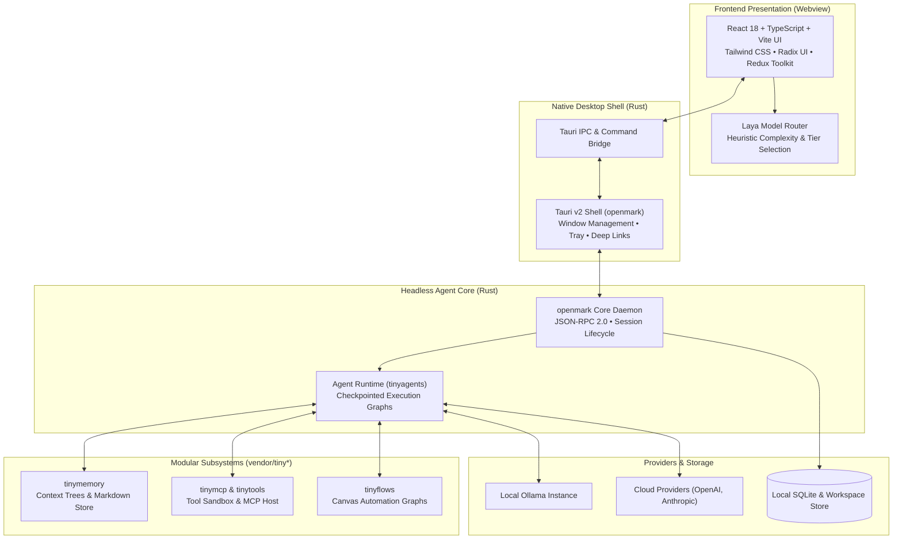

<p align="center">
  
</p>

<h1 align="center">OpenMark</h1>

<p align="center">
  <strong>Open-source desktop AI super-assistant and modular agent runtime.</strong><br>
  Built with React 18, TypeScript, Tailwind CSS, Tauri v2, and Rust.
</p>

<p align="center">
  <a href="#key-capabilities">Capabilities</a> •
  <a href="#system-architecture">Architecture</a> •
  <a href="#technology-stack">Tech Stack</a> •
  <a href="#installation--development">Quickstart</a> •
  <a href="#laya-adaptive-routing">Laya Router</a> •
  <a href="#license--attribution">License</a>
</p>

---

> [!NOTE]
> **Project Status:** Active Development & Stabilization.
> OpenMark is undergoing active core stabilization and showcase preparation. Production binary distribution is pending code-signing certification. Build from source or run via development mode for evaluation.

---

## What is OpenMark?

OpenMark is a local-first, privacy-respecting desktop AI application and modular agent execution runtime. Derived from [OpenHuman](https://github.com/tinyhumansai/openhuman) (v0.63.31), OpenMark decouples agent computing from proprietary cloud silos, giving users full ownership of their data, prompts, memory graphs, and automation workflows.

### Why OpenMark?
- **Durable Checkpointed Turns:** Agent turns execute as state graphs on `tinyagents` rather than ephemeral loops. A turn can pause for user approval, survive an application restart, and resume mid-flight.
- **On-Device Memory Ownership:** Context and conversations are summarized into transparent Markdown files and local SQLite databases on your filesystem—not trapped in remote databases.
- **Adaptive Model Routing (Laya):** Includes our experimental **Laya** routing engine, which heuristically estimates prompt complexity to dynamically assign queries across local models, fast reasoning tiers, or frontier cloud models.
- **Bring Your Own Key (BYOK) & Local LLMs:** Seamlessly toggle between local Ollama instances and direct cloud providers (Anthropic, OpenAI, OpenRouter, Groq, DeepSeek) with zero telemetry leaks.
- **Model Context Protocol (MCP):** Native support for the open MCP standard, allowing the agent to interface directly with external development tools, databases, and filesystem servers.

---

## Key Capabilities & Implementation Status

We provide an honest distinction between implemented code, automated tests, experimental features, and planned work:

| Capability | Source Evidence | Status |
|---|---|---|
| **Tauri v2 Desktop Shell** | `crates/openhuman-app/` | `IMPLEMENTED` / `TESTED` |
| **Checkpointed Agent Graphs** | `vendor/tinyagents/` | `IMPLEMENTED` / `TESTED` |
| **Laya Adaptive Model Router** | `app/src/features/laya/` | `IMPLEMENTED` / `TESTED` / `EXPERIMENTAL` |
| **Local Inference (Ollama)** | `crates/openhuman-core/src/api/config.rs` | `IMPLEMENTED` / `TESTED` |
| **Multi-Provider BYOK (Anthropic/OpenAI)** | `app/src/components/settings/panels/ai/` | `IMPLEMENTED` / `TESTED` |
| **Model Context Protocol (MCP)** | `vendor/tinymcp/` | `IMPLEMENTED` / `TESTED` |
| **Hierarchical Memory Trees** | `vendor/tinymemory/` | `IMPLEMENTED` |
| **Visual Workflow Canvas** | `vendor/tinyflows/` | `IMPLEMENTED` |
| **Deep Link Scheme (`openmark://`)** | `crates/openhuman-app/src/deep_link_ipc.rs` | `IMPLEMENTED` / `TESTED` |
| **Telemetry Stripping & Privacy** | `app/src/utils/config.ts` | `IMPLEMENTED` / `TESTED` |
| **Multi-Language Support (14 Locales)** | `app/src/lib/i18n/` | `IMPLEMENTED` / `TESTED` |
| **Native Notifications & Tray** | `crates/openhuman-app/src/native_notifications/` | `IMPLEMENTED` / `TESTED` |
| **Signed Production Releases** | `.github/workflows/openmark-build.yml` | `PLANNED` (Gated on Apple Developer ID) |
| **Managed Cloud Sync Relay** | `app/src/services/` | `PLANNED` (Gated on server backend) |

*For full capability breakdown, see [`docs/FEATURES.md`](docs/FEATURES.md).*

---

## System Architecture

OpenMark separates user interaction from backend agent coordination using a clean multi-layer IPC and RPC boundary:



*For detailed subsystem contracts, data flows, and sequence diagrams, refer to [`docs/ARCHITECTURE.md`](docs/ARCHITECTURE.md).*

---

## Technology Stack

### Frontend Application
- **Framework:** React 18 with TypeScript 5
- **Build Tool:** Vite with fast Hot Module Replacement (HMR)
- **Styling:** Tailwind CSS with CSS custom properties and Radix UI primitives
- **State Management:** Redux Toolkit with persisted user settings
- **Conversation Interface:** Assistant-UI streaming chat runtime

### Desktop Host & Native Core
- **Desktop Runtime:** Tauri v2 (Rust 2021)
- **Async Runtime:** Tokio with Axum JSON-RPC 2.0 services
- **Database & Storage:** SQLite (`rusqlite`) for local state and session indexes
- **Cryptography & Security:** Minisign release signature verification

### Agent Subsystems (`vendor/tiny*`)
- **`tinyagents`**: Checkpointed state machine execution graphs
- **`tinymemory`**: Hierarchical memory trees and Obsidian-compatible Markdown knowledge store
- **`tinymcp`**: Model Context Protocol client implementation (stdio & SSE)
- **`tinyflows`**: Visual trigger and automation graph builder
- **`tinyvoice`**: Real-time streaming voice input/output pipelines

---

## Repository Structure

```text
openmark/
├── app/                        # React / TypeScript desktop frontend
│   ├── src/
│   │   ├── components/         # UI components, layout shell, settings panels
│   │   ├── features/
│   │   │   ├── conversations/  # Chat threads, tool narration, timelines
│   │   │   └── laya/           # Laya adaptive routing engine & tests
│   │   ├── lib/i18n/           # Localization bundles (14 languages)
│   │   ├── services/           # JSON-RPC client & session coordinators
│   │   └── utils/              # Configuration, deep-links, external guards
│   └── test/                   # Vitest unit test suite
├── crates/
│   ├── openhuman-app/          # Tauri v2 desktop application shell
│   │   ├── icons/              # Multi-resolution OpenMark icons
│   │   └── src/                # Deep-link IPC, notifications, tray, crash recovery
│   └── openhuman-core/         # Headless Rust agent core daemon
│       └── src/                # JSON-RPC API, configuration, session engine
├── vendor/                     # 16 modular submodules (all GPL-3.0)
│   ├── tinyagents/             # Durable agent graph execution engine
│   ├── tinymemory/             # Local Markdown context & memory trees
│   ├── tinymcp/                # Model Context Protocol integration
│   └── tinyflows/              # Visual workflow canvas & trigger graphs
├── docs/                       # Showcase and architectural documentation
│   ├── ARCHITECTURE.md         # Subsystem boundaries and sequence diagrams
│   ├── DEVELOPMENT.md          # Setup, commands, and debugging guide
│   ├── FEATURES.md             # Verified implementation matrix
│   └── ROADMAP.md              # Engineering milestones & active goals
├── fork/                       # Publication audit & legal compliance records
│   ├── COMPLIANCE.md           # GPL-3.0 compliance & submodule license audit
│   └── GITHUB-PUBLISH-AUDIT.md # Pre-release change classification inventory
├── .github/workflows/          # GitHub Actions CI definitions
│   └── openmark-build.yml      # Multi-platform build & test workflow
├── Cargo.toml                  # Cargo workspace manifest
├── docker-compose.yml          # Self-hosted headless core container spec
└── LICENSE                     # GNU General Public License v3.0
```

---

## Installation & Development

### Prerequisites
- **Node.js**: `v24.x`
- **pnpm**: `10.10.0`
- **Rust**: `1.96.1` (stable toolchain)
- **macOS / Linux / Windows**: Standard C/C++ build tools (Xcode CLI tools on macOS)

> [!WARNING]
> On macOS, avoid running the repository inside iCloud-synced directories (`~/Desktop`, `~/Documents`). Sync locks degrade file I/O and break native database builds. Use a clean path like `~/dev/openmark`.

### Quickstart

```bash
# 1. Clone repository with all submodules
git clone --recurse-submodules https://github.com/NKishoreVarma/openmark.git
cd openmark

# 2. Install workspace and frontend dependencies (frozen lockfiles)
pnpm install --frozen-lockfile
cd app && pnpm install --frozen-lockfile && cd ..

# 3. Configure local environment
cp .env.example .env
cp app/.env.example app/.env.local

# 4. Start frontend development server (web preview)
cd app && pnpm dev

# 5. Or launch the full Tauri desktop application
cd app && pnpm dev:app
```

*For comprehensive command listings and build targets, see [`docs/DEVELOPMENT.md`](docs/DEVELOPMENT.md).*

---

## Configuration & Environment

OpenMark uses a two-tier configuration model:
1. **Core / Daemon Environment (`.env`):** Defines local port bindings, logging verbosity (`RUST_LOG=info`), and optional local inference endpoints.
2. **Frontend Environment (`app/.env.local`):** Defines Vite build-time feature flags (`VITE_LAYA_ROUTING_ENABLED`).

**Security Guarantee:** OpenMark ships zero default tracking tokens. The upstream OpenPanel analytics ID has been eliminated from defaults (`app/src/utils/config.ts`), and Sentry reporting is disabled unless an explicit DSN is provided by the self-hoster.

---

## Verification & Testing

OpenMark maintains rigorous unit and static-analysis test coverage across frontend components and native Rust crates:

```bash
# Run TypeScript compilation check
cd app && pnpm compile

# Run frontend unit tests (Vitest)
cd app && pnpm test

# Run Rust core unit checks
pnpm rust:check

# Run Rust formatting verification
pnpm --filter openhuman-app rust:format:check
```

> [!IMPORTANT]
> **Testing Disclosure:** Following migration to the standalone `~/dev/openmark` tree, fresh full-suite test results are being established. Historical test counts from upstream are not claimed as current verification.

---

## Laya Adaptive Model Routing

OpenMark includes **Laya**, an experimental prompt-complexity routing architecture:
- **Heuristic Scorer:** Evaluates token density, syntax structures, and reasoning requirements.
- **Dynamic Tiering:** Routes turns to Local LLMs (Ollama), Light models, or Frontier models.
- **Evidence Threshold Gate:** Runs in shadow mode until achieving ≥200 observations with ≥75% estimated precision before taking over active dispatch.
- **User Override:** Includes an in-turn UI badge with a one-click **"Redo with frontier model"** option.

---

## Roadmap & Known Limitations

### Current Limitations:
- **Desktop Release Gate:** Notarized public macOS `.dmg` and Windows installers require Developer ID signing keys. Source compilation is the current recommended path.
- **Cloud Relays:** Server-side managed authentication relays are not yet deployed; use local BYOK or Ollama inference.

### Upcoming Milestones:
- [ ] Fresh test suite certification across the entire matrix.
- [ ] Empirical qualification of the Laya routing scoring model.
- [ ] Self-hosted headless daemon deployment recipes (Docker / Kubernetes).

*See [`docs/ROADMAP.md`](docs/ROADMAP.md) for detailed project milestones.*

---

## License & Attribution

OpenMark is licensed under the **GNU General Public License v3.0 (GPL-3.0)**.

OpenMark is a modified version of [OpenHuman](https://github.com/tinyhumansai/openhuman) by TinyHumans AI. In accordance with GPL-3.0 §5(a), modifications have been introduced by the OpenMark contributors while preserving all original copyright notices, disclaimers, and reciprocal licensing obligations.

Per GPL-3.0 requirements, in-app attribution and source links are rendered in `app/src/components/settings/panels/AboutPanel.tsx`. For detailed license verification across all 16 vendor submodules, see [`fork/COMPLIANCE.md`](fork/COMPLIANCE.md).
