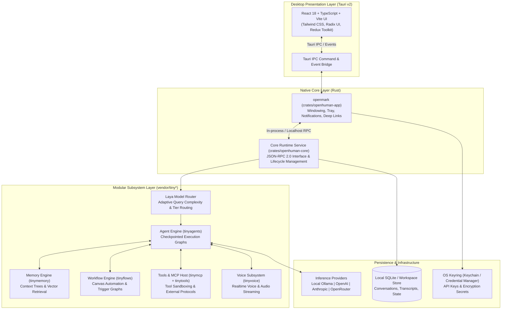
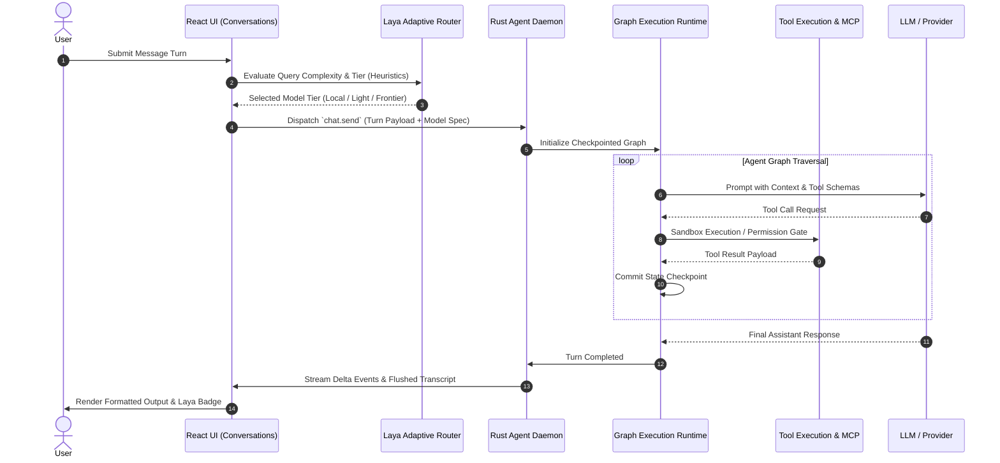

# OpenMark Architecture & Subsystem Specification

OpenMark is a local-first, modular desktop AI assistant built with **Tauri v2**, **Rust**, and **React 18 / TypeScript**. It couples an expressive desktop client with an extensible, checkpointed agent runtime capable of multi-turn execution, tool invocation, sub-agent delegation, and intelligent model routing.

---

## 1. High-Level Architecture Overview

---

## 2. System Boundaries & Responsibilities

### Presentation Layer (`app/`)
- **Technology:** React 18, TypeScript, Vite, Tailwind CSS, Redux Toolkit, Assistant-UI.
- **Responsibilities:**
  - Manages interactive user conversations, markdown formatting, tool-call timelines, and approval dialogs.
  - Controls window states, theme switching (dynamic contrast, system preferences), and notifications.
  - Maintains client-side state for active threads, streaming transcript deltas, and user settings.
  - Hosts the **Laya Routing Panel** and turn badges for real-time model tier observability.

### Desktop Shell (`crates/openhuman-app`)
- **Technology:** Tauri v2, Rust 2021 edition.
- **Responsibilities:**
  - Native windowing, system menu, tray icon, and global shortcut listeners.
  - Handles deep-link URL protocol schemes (`openmark://oauth/success`, `openmark://link/*`).
  - Native notification dispatching and OS-level crash recovery.
  - Embeds the cryptographic updater verifying releases via Minisign public key signatures.

### Headless Core Service (`crates/openhuman-core`)
- **Technology:** Rust, Tokio async runtime, Axum / JSON-RPC.
- **Responsibilities:**
  - Exposes JSON-RPC endpoints for session management, tool invocation, and streaming agent turns.
  - Isolates workspace state in `~/.openmark/workspace/`.
  - Normalizes external provider endpoints and coordinates local/remote inference fallbacks.
  - Manages long-lived background daemons, scheduled tasks, and webhook triggers.

---

## 3. The Agent Execution Pipeline

Unlike simplistic single-loop chat interfaces, OpenMark turns execute as **checkpointed state graphs** managed by `tinyagents`:

### Key Graph Characteristics:
1. **Durable Checkpointing:** Each graph step is written to the local transaction log. A sudden crash or restart resumes from the last completed node rather than re-running destructive side effects.
2. **Sub-Agent Fleets:** An agent turn can spawn depth-bounded specialist sub-agents (e.g. researcher, coder, reviewer). Sub-agents communicate through encrypted channels and return structured findings to the primary coordinator.
3. **Approval Gating:** Actions requiring external side effects (file modifications, outbound API calls, terminal commands) pause the graph and dispatch a pending approval request to the desktop UI.

---

## 4. Laya Adaptive Model Routing

OpenMark incorporates **Laya**, an exclusive adaptive routing engine designed to optimize latency, cost, and token usage without sacrificing reasoning quality.

### Architecture Components:
- **`layaScorer.ts`**: Analyzes turn prompts using lightweight heuristic criteria:
  - Input length and prompt token density.
  - Code syntax presence, language markers, and technical terminology.
  - Multi-step reasoning signals, formatting specifications, and tool intent.
- **`layaRouter.ts`**: Maps scored complexity into execution tiers:
  - **Local Tier:** On-device models (e.g. Ollama Llama 3.2 / Qwen) for trivial queries and formatting.
  - **Light Tier:** Rapid cloud models for standard conversational exchanges.
  - **Frontier Tier:** High-capability models (Claude 3.5 Sonnet, GPT-4o) for architecture, synthesis, and coding.
- **Shadow Verification Gate:** To protect user experience, Laya runs in **shadow observation mode** until it records at least **200 turns** with **≥75% estimated precision** before taking over active dispatch.
- **Frontier Redo:** If any user feels an answer needs higher reasoning power, the UI provides a one-click **"Redo with frontier model"** action that bypasses the router.

---

## 5. Security & Isolation Model

- **Local Storage:** All transcripts, credentials, and settings remain on the local machine under the user's home directory.
- **Secret Management:** Sensitive API keys are stored in the platform keychain or supplied at runtime via environment variables; they are never persisted in plaintext files.
- **Telemetry Independence:** All unsolicited telemetry endpoints, third-party analytics trackers, and remote tracking beacons have been severed or defaulted to disabled.
- **Tool Sandboxing:** Untrusted skill execution is isolated inside memory-constrained sandboxes (QuickJS / WebAssembly) with strict filesystem boundaries.
